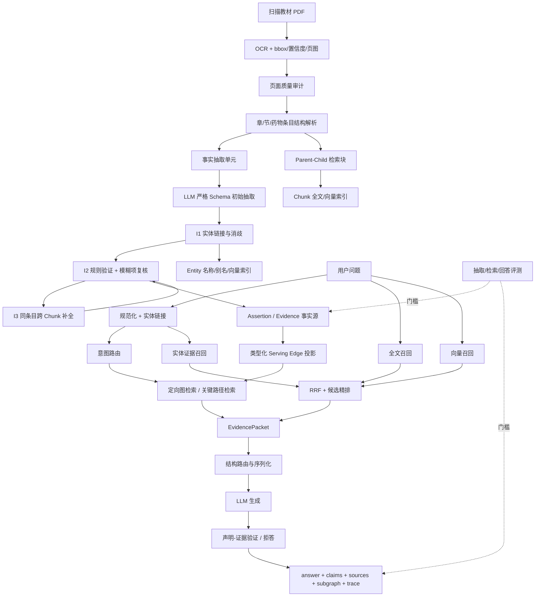

# GraphRAG《中药学》三部分技术文档可行性评审与总体系统设计

> 评审对象  
> 1. `GraphRAG中药学_知识图谱构建环节优化方案_最终版.md`  
> 2. `GraphRAG中药学_检索环节优化方案_最终版.md`  
> 3. `中药学知识工程创新.md`（PathRAG + StructRAG 设想）  
> 4. `中草药知识图谱管线改进建议.md` 作为横向工程审计基线  
>
> 评审范围：本报告评估文档设计是否可实现、各部分是否能组合、哪些地方必须改动，以及适合 4–5 人课程项目的最终架构。由于本轮没有再次逐文件审计仓库源码，涉及“当前代码是否已经具备某行为”的判断，以所附审阅文档为依据；正式开发前仍应在锁定的仓库提交上执行验收脚本。

---

## 1. 总体结论

### 1.1 一句话结论

三部分的方向是对的，且能够组成一个完整的“证据优先型中药学 GraphRAG”系统；但不能原样并行开工。必须先统一数据模型、接口契约和版本机制，再分别实现建图、检索与结构化注入。

建议最终采用：

> **证据断言层作为事实源，类型化关系层作为检索投影；查询侧先路由，再按问题类型检索，最后将证据整理为表格、约束矩阵、关系路径或章节摘要后生成答案。**

这能同时解决四份文档之间最明显的冲突：

- 建图文档希望保留简单、快速的实体间直接边；
- 管线审计文档希望引入 `Assertion` 以保存证据、版本和冲突；
- 检索文档需要类型化关系以执行快速的属性聚合、反向检索与交集；
- 注入文档希望把结果组织为路径或其他结构，而不是扁平三元组。

### 1.2 可行性评分

| 部分 | 技术可行性 | 当前文档完备度 | 主要风险 | 结论 |
|---|---:|---:|---|---|
| 知识图谱构建 | 8.5/10 | 8/10 | 实体误合并、证据匹配过脆、阈值未经标定 | 可直接作为主线，修正若干模型与存储细节后实施 |
| 检索 | 8/10 | 8.5/10 | `name` 唯一约束错误、PPR“软交集”定义不严谨、功能面过宽 | 主体可落地；需删掉/改写 4 个关键设计 |
| PathRAG + StructRAG 注入 | 7/10 | 3/10 | 只有理念，没有数据契约、路由、序列化和验证流程 | 适合作为第三部分创新，但必须补成“结构化证据编排层” |
| 端到端系统 | 8/10 | 6.5/10 | 跨模块契约不统一、一次性改造范围过大 | 通过统一架构和内部里程碑可完成 |

---

## 2. 三部分逐项评审

## 2.1 第一部分：知识图谱构建

### 2.1.1 可行且应该保留的设计

1. **I1 实体消歧与别名归一化**  
   “文本规范化 → 权威别名精确匹配 → 字符/向量候选召回 → 类型与上下文确认”的分层流程合理。它比单纯按 embedding 阈值合并安全，尤其适合“人参、红参、生晒参”这类有关联但不等价的实体。

2. **I2 关系证据与二次校验**  
   受控关系、domain/range、逐字证据、否定与单位检查，是中药教材建图最重要的质量门。文档强调 Precision 优先于关系数量，这个取舍正确。

3. **I3 跨 Chunk 补全**  
   只处理相邻块、同一条目或同一 section，并让新增候选重新经过 I2，复杂度和幻觉风险都可控。

4. **统一 LLMClient 与可关闭的消融开关**  
   这使模型供应商、Prompt、Schema 和实验配置解耦，便于多人协作和答辩展示。

### 2.1.2 必须修改的地方

#### A. 不要让 `support_score` 同时承担“规则分”和“最终可信度”

现有文档把 `llm_verify_score` 直接放进统一线性公式，但高分候选可能根本不会进入 LLM 二次校验，导致字段语义不一致。

建议拆成：

```python
@dataclass(frozen=True)
class ValidationResult:
    rule_score: float
    rule_flags: list[str]
    review_required: bool
    llm_verdict: Literal["SUPPORTED", "UNSUPPORTED", "NOT_RUN"]
    final_score: float
    status: Literal["ACCEPTED", "REVIEW", "REJECTED"]
```

推荐流程：

```text
先算 rule_score
  ├─ 明确非法：REJECT
  ├─ 明确支持：ACCEPT
  └─ 模糊区：调用 LLM verifier
                 ↓
             计算 final_score
```

`final_score` 仍然只是排序和决策支持值，不应被描述为真实概率。

#### B. `evidence_quote in source_text` 对 OCR 文本过于脆弱

OCR 可能出现空格、换行、全半角和标点差异。应保存原始文本与规范化文本，并让证据返回字符跨度：

```json
{
  "evidence_quote": "归脾、肺经",
  "evidence_start": 18,
  "evidence_end": 24,
  "match_mode": "normalized_exact"
}
```

证据匹配顺序：

1. 原文字符跨度校验；
2. 规范化后精确子串；
3. 仅允许极小编辑距离的模糊对齐；
4. 仍无法定位则进入 `REVIEW`，不能正式入图。

#### C. “剂量”不宜只作为普通可合并实体

`9～30g`、`煎服`、`儿童减量`、`先煎`等往往带条件。建议将剂量设计为值对象或断言限定符：

```json
{
  "predicate": "HAS_DOSAGE",
  "object": {
    "value_min": 9,
    "value_max": 30,
    "unit": "g",
    "route": "煎服",
    "condition": null
  }
}
```

若为了前端展示仍建 `DOSAGE` 节点，也必须把标准化数值与条件保存在 `Assertion.qualifiers` 中，不能只保存字符串。

#### D. 相邻 Chunk 只是回退策略，结构条目 ID 才应是主依据

跨块补全前必须先拥有：

```text
document_id
section_path
entry_id
parent_chunk_id
chunk_order_in_entry
page_start/page_end
```

优先在同一 `entry_id` 内配对；只有结构解析失败时才退到“相邻 Chunk + 锚点实体”。

#### E. 阈值必须通过开发集标定

`0.94/0.84`、`0.85/0.60`只能作为初始配置，不得写入报告结论。开发集中应画出 Precision/Recall 或错误合并率曲线，再冻结阈值。

### 2.1.3 建图部分最终判断

该部分是三部分中最成熟的一块，可作为项目 P0 主线。真正影响可行性的不是 LLM 能否抽取，而是：

- 是否有稳定 `canonical_id`；
- 是否每条事实都能定位到原文；
- 是否能原子发布与回滚；
- 是否有金标准集和失败清单。

---

## 2.2 第二部分：检索

### 2.2.1 可行且有较强创新表达的设计

1. **从“固定 N 跳”改为“问题类型 → 定向链路”**  
   `attr / reverse / intersect / compare` 的路由非常适合教材型知识图谱，且比通用的 `rel*0..2` 更容易解释和消融。

2. **全文、向量、实体三路召回 + RRF**  
   全文与向量分数不在同一量纲，按排名融合是合理选择。自研中文 n-gram BM25 可保留为候选精排，而不是扫描全库。

3. **跨块类型化遍历**  
   属性聚合、反向查药、多约束交集都必须跨 Chunk 使用规范实体，这是整个 GraphRAG 相对纯向量 RAG 最容易展示价值的部分。

4. **安全路由与 provenance 强制**  
   对剂量、毒性、禁忌等问题要求逐字证据、页码和证据不足拒答，符合项目领域风险。

5. **四种前端模式作为基线与消融**  
   保留 `vector / vector_cypher / hybrid_cypher / best` 有利于答辩中说明每个模块到底带来什么。

### 2.2.2 四个必须修正的关键问题

#### A. 不得对 `name` 建唯一约束

文档提出“每种标签下 `name` 唯一”，这和实体消歧设计冲突。中药领域可能存在同名异物、同名不同来源或不同粒度概念。

正确做法：

```cypher
CREATE CONSTRAINT entity_canonical_id IF NOT EXISTS
FOR (e:Entity) REQUIRE e.canonical_id IS UNIQUE;

CREATE INDEX entity_normalized_name IF NOT EXISTS
FOR (e:Entity) ON (e.normalized_name);
```

`name/preferred_name` 用于展示和召回，`canonical_id` 才是身份。

#### B. 关系槽归一应在建图侧完成，检索侧映射只保留兼容用途

新版本不应继续让“具有功效/功效为/功效”作为真实关系类型写入图中。正式关系必须在建图阶段归一为 `HAS_EFFICACY` 等稳定 ID。

检索侧 `RELATION_SLOTS` 仅用于：

- 读取旧图；
- 迁移期间统计未知关系；
- 兼容历史基线。

#### C. 单次“多种子 PPR”不是严格的软交集

把多个约束放进一个 personalization 向量，本质更接近“靠近任一或总体种子”的联合扩散，不能保证结果同时满足全部条件。

推荐顺序：

```text
1. 精确硬交集
2. 按满足约束数量、证据强度排序
3. 仍需软匹配时，对每个约束分别计算 PPR/距离分
4. 使用几何均值、最小值或调和均值聚合，惩罚只靠近一个约束的药物
```

示例：

```python
soft_score = geometric_mean([
    max(eps, ppr_from_seed_i[drug_id])
    for seed_i in constraint_ids
])
coverage = matched_constraints / len(constraint_ids)
final = 0.7 * soft_score + 0.3 * coverage
```

输出必须明确区分“全部满足”和“部分接近”，不能把软交集当作教材明确事实。

#### D. 图版本不能用节点数作为缓存失效标记

节点名称、别名、关系和证据更新时，节点数可能不变。应使用：

```text
active_run_id
graph_revision
schema_version
embedding_version
```

作为实体词典、图快照和章节摘要缓存键。

### 2.2.3 其他建议

- `names_sorted = sorted(...)` 不要每次查询重算，应随词典缓存，或使用 Trie/Aho–Corasick。
- 实体向量阈值 `0.80` 不能直接确认实体，只能生成候选。
- `compare` 路由应优先识别“比较/区别/异同”，再执行实体数量规则。
- PathRAG 不应覆盖属性查询；单药属性题用星形卡片更直接。
- `top_k=50/5` 是可接受的初值，但最终应由 Recall@K 和延迟曲线决定。
- NetworkX PPR 只应在过滤后的领域实体图上运行，排除 `Chunk/Document/Mention/Assertion` 等审计节点。

### 2.2.4 Neo4j 版本判断

固定 Neo4j 5.26 LTS + Python Driver 6.x 是兼容的。对于 5.26，`db.index.vector.queryNodes` 是可用方案；如果未来升级到 Neo4j 2026 系列，应准备切换到新的 `SEARCH` 语法。全文分析器必须在目标容器上通过 `db.index.fulltext.listAvailableAnalyzers()` 实测，不能仅假设 `cjk` 一定存在。

---

## 2.3 第三部分：PathRAG + StructRAG 知识注入

### 2.3.1 当前设想为什么合理

第三份文档准确指出了两个问题：

- 图检索把邻居整团塞入模型，噪声和 token 开销大；
- 不同问题都使用同一种扁平三元组 Prompt，结构与任务不匹配。

PathRAG 的核心正是从相关节点之间寻找关键关系路径并进行剪枝；StructRAG 的核心是按任务选择结构、重构知识，再利用结构进行推理。因此，这两种思想与中药问答中的多跳路径、属性表、配伍禁忌和章节比较高度匹配。

### 2.3.2 当前文档为什么还不能直接开发

只有“路径”和“结构化注入”的概念，缺少以下必需定义：

- 什么时候使用路径，什么时候不用；
- 路径候选从哪些节点和关系中生成；
- 路径长度、分支数和证据质量如何限制；
- 表格、矩阵、路径、摘要的统一输入协议；
- 结构化结果怎样绑定页码与逐字证据；
- 生成后怎样验证每个结论；
- 失败时如何降级或拒答。

### 2.3.3 推荐将第三部分实现为“Evidence Structuring Layer”

不要完整复现 StructRAG 的训练式路由，也不要把 PathRAG 强行用于所有问题。课程项目应实现一个轻量、可控、可消融的结构化证据编排层：

| Query intent | 推荐结构 | 适用场景 |
|---|---|---|
| `attr` | 属性卡片/键值表 | 某味药的性味、归经、功效、用量 |
| `reverse` | 排名表 | 哪些药治疗某病证 |
| `intersect` | 约束矩阵 | 同时满足多个功效/主治 |
| `compare` | 双列/多列表 + 章节证据 | 药物、药类或概念比较 |
| `path` | 有序关系路径包 | 配伍、治法、方药链等多跳问题 |
| `safety` | 逐字证据卡 | 剂量、禁忌、毒性、孕妇等高风险问题 |
| `fallback` | 原文块列表 | 实体链接或图检索失败 |

统一中间表示：

```python
@dataclass
class EvidenceItem:
    evidence_id: str
    claim_key: str | None
    subject_id: str | None
    predicate: str | None
    object_id: str | None
    path: list[dict] | None
    evidence_quote: str
    chunk_id: str
    page_start: int
    page_end: int
    support_score: float
    retrieval_score: float
    qualifiers: dict

@dataclass
class EvidencePacket:
    query_id: str
    intent: str
    linked_entities: list[dict]
    structure_type: str
    items: list[EvidenceItem]
    warnings: list[str]
    token_budget: int
```

结构化序列化器只消费 `EvidencePacket`，生成器不直接访问 Neo4j。

### 2.3.4 PathRAG 的合理落地边界

仅在以下条件触发路径检索：

```text
- 问题被路由为 path；
- 或链接到两个及以上关键实体；
- 或问题明确包含“如何、为何、通过什么、配伍、治法链”等多跳意图。
```

候选子图必须：

- 排除 `FROM_CHUNK/MENTIONED_IN/EVIDENCED_BY` 等审计边；
- 只允许领域关系白名单；
- 默认最大路径长度 3；
- 每个查询限制候选节点与路径数量；
- 每条路径至少有一个可定位证据；
- 高风险关系全部有逐字证据。

可采用“PathRAG-inspired”评分，而非声称完整复现：

```python
path_score = (
    0.25 * query_entity_relevance
    + 0.25 * min_edge_support
    + 0.20 * evidence_coverage
    + 0.15 * relation_prior
    + 0.15 * length_decay
)
```

只有确实实现论文中的节点检索、流量剪枝、路径可靠度和路径式 Prompt，才能在报告中写“复现 PathRAG”；否则应写“借鉴 PathRAG 的关键路径检索与剪枝思想”。

### 2.3.5 生成与校验

生成 API 推荐返回：

```json
{
  "answer": "...",
  "claims": [
    {
      "text": "...",
      "evidence_ids": ["EV_xxx"],
      "page_start": 132,
      "page_end": 133,
      "verification": "SUPPORTED"
    }
  ],
  "sources": [],
  "subgraph": {"nodes": [], "edges": []},
  "trace": {},
  "abstained": false
}
```

生成后执行：

1. `evidence_id` 必须属于本次 `EvidencePacket`；
2. 引用原句必须真实存在；
3. 数值、单位、否定词必须与证据一致；
4. 无支持的关键句删除或重写；
5. 高风险问题证据不足则 `abstained=true`。

---

## 3. 统一总体架构



---

## 4. 双层图数据模型

## 4.1 事实源层：Assertion / Evidence Graph

```text
(Document)-[:HAS_PAGE]->(Page)
(Page)-[:CONTAINS]->(Chunk)
(Section)-[:CONTAINS]->(Chunk)
(Chunk)-[:PARENT_OF]->(Chunk)

(Entity)-[:HAS_MENTION]->(Mention)-[:IN_CHUNK]->(Chunk)

(Assertion)-[:SUBJECT]->(Entity)
(Assertion)-[:OBJECT]->(Entity|ValueObject)
(Assertion)-[:EVIDENCED_BY]->(Chunk)
(Assertion)-[:IN_RUN]->(IngestRun)
```

`Assertion` 至少包括：

```text
assertion_id
fact_key
predicate
polarity
qualifiers
evidence_quote
evidence_start/evidence_end
support_score
validation_status
extractor_model
prompt_version
schema_version
run_id
created_at
```

事实键：

```text
fact_key = hash(
  subject_canonical_id
  + predicate
  + object_canonical_id_or_value
  + normalized_qualifiers
  + polarity
)
```

同一事实可以有多个 Assertion/证据；冲突事实不应直接覆盖。

## 4.2 服务投影层：Typed Serving Graph

对所有 `ACTIVE + ACCEPTED` 的事实投影为：

```text
(Herb)-[:HAS_EFFICACY]->(Efficacy)
(Herb)-[:TREATS]->(Indication)
(Herb)-[:ENTERS_MERIDIAN]->(Meridian)
...
```

边属性：

```text
fact_key
best_support_score
evidence_count
evidence_ids
page_start/page_end
active_run_id
```

优点：

- 检索使用原生类型化关系，查询简单、快；
- 审计、版本、冲突和多来源由 Assertion 层承担；
- Serving Edge 可以重建，不作为唯一事实源；
- 建图与检索文档不再互相冲突。

---

## 5. 稳定 ID 与版本规范

```text
document_id  = sha256(file_bytes + edition)[:20]
page_id      = document_id + ":" + page_no
section_id   = sha256(document_id + section_path)[:20]
chunk_id     = sha256(document_id + section_path + normalized_content)[:24]
mention_id   = sha256(chunk_id + start + end + surface)[:24]
canonical_id = TYPE + ":" + stable_uuid_or_authority_id
assertion_id = sha256(fact_key + chunk_id + evidence_span + schema_version)[:24]
run_id       = ULID/UUIDv7
```

所有缓存键必须包含影响结果的版本：

```text
OCR: file_hash + ocr_model + dpi + ocr_config_version
Extraction: chunk_hash + llm_model + prompt_version + schema_version
Embedding: text_hash + embedding_model + embedding_version
Summary: section_hash + summarizer_model + prompt_version
```

---

## 6. 代码模块总纲

```text
graphragexpr/
├── config/
│   ├── settings.py
│   └── feature_flags.py
├── domain/
│   ├── models.py
│   ├── ontology.py
│   ├── ontology.yaml
│   └── errors.py
├── ingest/
│   ├── ocr.py
│   ├── quality.py
│   ├── structure.py
│   └── chunking.py
├── extract/
│   ├── llm_client.py
│   ├── extractor.py
│   ├── relation_validator.py
│   └── cross_chunk.py
├── linking/
│   ├── alias_store.py
│   ├── candidate_retriever.py
│   └── entity_resolver.py
├── storage/
│   ├── neo4j_store.py
│   ├── assertions.py
│   ├── serving_projection.py
│   ├── indexes.py
│   └── migrations/
├── retrieval/
│   ├── entity_linker.py
│   ├── router.py
│   ├── sparse.py
│   ├── dense.py
│   ├── fusion.py
│   ├── traversal.py
│   ├── path_retriever.py
│   ├── intersection.py
│   └── trace.py
├── structuring/
│   ├── evidence_packet.py
│   ├── structure_router.py
│   ├── table_serializer.py
│   ├── matrix_serializer.py
│   ├── path_serializer.py
│   └── summary_serializer.py
├── generation/
│   ├── prompt_builder.py
│   ├── answer_generator.py
│   ├── citation_verifier.py
│   └── safety.py
├── evaluation/
│   ├── extraction/
│   ├── retrieval/
│   ├── generation/
│   └── ablation.py
├── api/
│   ├── schemas.py
│   ├── routes.py
│   └── health.py
└── tests/
```

依赖方向：

```text
domain/config
  ↑
ingest → extract/linking → storage
  ↑                       ↓
retrieval → structuring → generation → api
                    ↘ evaluation ↙
```

禁止反向依赖，例如 `extract` 不得导入 `api`，`generation` 不得直接写 Neo4j。

---

## 7. 关键接口契约

## 7.1 抽取接口

```python
class LLMClient(Protocol):
    def extract(self, unit: ExtractionUnit, schema: Ontology) -> RawExtraction: ...
    def resolve_entity(self, request: EntityResolutionRequest) -> EntityResolutionDecision: ...
    def verify_assertion(self, request: AssertionVerificationRequest) -> VerificationDecision: ...
    def complete_cross_chunk(self, request: CrossChunkRequest) -> list[AssertionCandidate]: ...
```

## 7.2 检索计划

```python
@dataclass(frozen=True)
class RetrievalPlan:
    intent: Literal["attr", "reverse", "intersect", "compare", "path", "fallback"]
    linked_entity_ids: tuple[str, ...]
    allowed_predicates: tuple[str, ...]
    max_hops: int
    require_provenance: bool
    structure_type: Literal["card", "table", "matrix", "paths", "summary", "chunks"]
```

## 7.3 对外响应

```python
class QAResponse(BaseModel):
    answer: str
    method: str
    claims: list[Claim]
    sources: list[Source]
    subgraph: Subgraph
    trace: Trace
    abstained: bool
    warnings: list[str]
```

现有前端所需的 `answer/method/subgraph/sources` 保持兼容，其余字段只增不删。

---

## 8. 检索与结构化注入的推荐主链

```text
Question
  → 规则规范化
  → 实体链接
  → Query Router
  → 三路召回
  → RRF
  → 按 intent 执行图查询
  → 去重、证据质量过滤、token 预算
  → EvidencePacket
  → Structure Router
  → 确定性序列化
  → LLM 生成
  → Claim–Evidence 校验
  → 答案或拒答
```

### 8.1 各意图执行策略

#### `attr`

- 中心实体：`HERB`
- 只走属性关系白名单
- 按槽位聚合
- 返回属性卡片 + 每项证据

#### `reverse`

- 从 `EFFICACY/INDICATION` 反向查 `HERB`
- 以证据条数、最佳支持度和检索相关性排序
- 不因同一事实多次 OCR 重复而重复计数

#### `intersect`

- 先做规范实体邻域的精确交集
- 无精确结果时返回“部分满足”矩阵
- PPR/图距离仅用于排序，不生成新事实

#### `compare`

- 分别生成两个对象的同槽位卡片
- 对齐后形成差异表
- 对药类比较可加入章节摘要，但结论仍需证据块支持

#### `path`

- 初始节点相关性召回
- 构建受限候选子图
- 生成有限长度简单路径
- 以边支持度、证据覆盖和长度衰减剪枝
- 输出关系路径，不输出整个邻域

#### `safety`

- 强制逐字证据
- 数值、单位、否定词专门核验
- 禁止仅靠章节摘要作答
- 无充分证据直接拒答

---

## 9. 评测与发布门槛

## 9.1 数据集

### 抽取集

- 50–60 个代表性药物条目；
- 300–500 条事实；
- 至少 20% 为跨 Chunk、别名、否定、剂量或禁忌难例；
- 关键测试集双人标注并仲裁；
- 开发集与最终测试集分离。

### 检索集

建议不少于 120 题：

| 类型 | 建议数量 |
|---|---:|
| attr | 25 |
| reverse | 20 |
| intersect | 20 |
| compare | 20 |
| path | 20 |
| safety / unanswerable | 15 |

### 回答集

所有问题保留：

```text
gold answer points
gold pages/chunks
required facts
forbidden unsupported claims
should_abstain
```

## 9.2 指标

建图：

- Entity P/R/F1；
- Entity Linking Accuracy；
- False Merge Rate；
- Relation P/R/F1；
- Evidence Span Match；
- Unsupported Relation Rate；
- Negation Accuracy；
- Dose Value/Unit Accuracy；
- Cross-Chunk P/R/F1。

检索：

- Recall@5、Recall@10；
- MRR、nDCG@10；
- Fact Recall；
- 属性槽覆盖率；
- Path Recall/Precision；
- 页码正确率；
- 子图噪声率；
- 延迟、token 和 LLM 调用次数。

生成：

- 要点正确率与覆盖率；
- Citation Precision/Recall；
- Unsupported Claim Rate；
- 高风险证据覆盖率；
- 应拒答问题的拒答准确率。

## 9.3 发布门槛

建议 P0 门槛：

```text
accepted assertion 证据覆盖率 = 100%
关键关系人工抽检 Precision ≥ 95%
False Merge Rate 不超过团队冻结阈值
检索 Recall@5 ≥ 90%（在冻结问题集上）
高风险关键句引用覆盖率 = 100%
任何核心指标显著回退则不激活新 run
```

数值门槛应在第一轮标注后冻结，不能为了“通过”临时改测试集。

---

## 10. 消融矩阵

至少比较：

```text
B0 纯向量 RAG
B1 全文 + 向量 Hybrid
B2 Hybrid + 实体链接
B3 B2 + 定向图检索
B4 B3 + 关键路径检索
B5 B4 + 结构化注入
B6 B5 + Claim–Evidence 校验
```

建图侧：

```text
KG0 初始 LLM 抽取
KG1 + 实体消歧
KG2 + 关系验证
KG3 + 跨 Chunk 补全
KG4 + Assertion 证据层与版本发布
```

每个模块必须有 Feature Flag，且使用同一份问题集与同一份图版本运行。

---

## 11. 适合 5 人团队的职责边界

| 角色 | 主责 | 交付物 | 必须协作对象 |
|---|---|---|---|
| A 数据与 OCR | OCR、质量审计、结构解析、Chunk | 稳定 `ChunkRecord` 与质量报告 | B、E |
| B 建图与本体 | Schema、抽取、I1/I2/I3、Assertion | 可重复构建的 Evidence Graph | A、C |
| C 检索 | 索引、实体链接、路由、定向遍历、路径 | `EvidencePacket` | B、D |
| D 结构化注入与生成 | Structure Router、序列化、Prompt、安全 | `QAResponse` | C、E |
| E 评测与集成 | 金标准、API、前端契约、CI、消融 | 发布门槛与演示系统 | 全员 |

建议交叉评审：

```text
A ↔ B：文本边界与证据跨度
B ↔ C：实体/关系与 Cypher 契约
C ↔ D：EvidencePacket 与 token 预算
D ↔ E：引用验证与回答指标
E ↔ A：数据版本与可复现实验
```

---

## 12. 内部实施里程碑

虽然最终可以“一次性交付完整改造”，开发过程仍必须按依赖顺序集成：

### M0：冻结契约

- 本体与关系白名单；
- Pydantic 数据模型；
- ID、版本和缓存规范；
- API 响应契约；
- 测试集格式。

### M1：稳定 Baseline

- 锁定代码提交与依赖；
- 运行旧链路并保存结果；
- 建立最小评测集；
- 禁止先删旧实现再补基线。

### M2：Evidence KG

- 结构化 Chunk；
- I1/I2/I3；
- Assertion + Serving Edge；
- 原子构建与激活。

### M3：检索主链

- 索引与 health；
- 三路召回与 RRF；
- `attr/reverse/intersect/compare`；
- `EvidencePacket`。

### M4：Path 与结构化注入

- 受限路径检索；
- 表格/矩阵/路径/摘要序列化；
- Claim–Evidence 校验；
- 高风险拒答。

### M5：集成与消融

- 四种前端模式；
- 完整指标；
- Linux 环境与一键脚本；
- 文档、演示案例和答辩图表。

---

## 13. 最终必须冻结的架构决策

1. **Neo4j 5.26 LTS 固定，不使用浮动 latest。**
2. **Python Driver 6.x 可用，但所有 API 在目标环境跑契约测试。**
3. **不依赖 `neo4j-graphrag`，检索主链使用原生驱动。**
4. **事实源为 Assertion，类型化直接边为可重建投影。**
5. **实体身份只认 `canonical_id`，不认 `name`。**
6. **正式关系在建图侧归一，检索槽映射只兼容旧图。**
7. **所有正式事实必须有可定位证据。**
8. **路径检索按意图触发，不覆盖简单属性题。**
9. **StructRAG 采用轻量结构路由，不复现 DPO 路由训练。**
10. **任何模型、Prompt、Schema、Embedding 改动都必须升版本并失效对应缓存。**
11. **新构建先 `BUILDING`，质量通过后原子切换到 `ACTIVE`。**
12. **项目报告中严格区分“完整复现”“借鉴实现”“未采用”。**

---

## 14. 外部技术核验

- Neo4j 官方文档确认：Python Driver 6.x 支持 Neo4j 5.x；5.26 是 LTS。
- Neo4j 5.26 可使用 `db.index.vector.queryNodes`。在 2026 系列中，官方已推荐 `SEARCH`，并从 2026.04 起将旧过程标为 deprecated，因此本项目应将 5.26 作为明确兼容基线。
- Neo4j 官方建议显式配置向量维度，并指出全文与向量结果应独立排序后融合，不能直接比较原始分数。
- PathRAG 论文的核心为相关节点检索、基于流量的关系路径剪枝、路径可靠度排序和路径式 Prompt。
- StructRAG 论文包含结构路由、知识结构化和结构利用三个环节；原论文还使用了训练式路由与大模型结构化，因此课程项目更适合做规则优先的轻量借鉴版。

参考：

- Neo4j Vector Indexes: https://neo4j.com/docs/cypher-manual/current/indexes/semantic-indexes/vector-indexes/
- Neo4j Full-text Indexes: https://neo4j.com/docs/cypher-manual/current/indexes/semantic-indexes/full-text-indexes/
- Neo4j Python Driver Installation: https://neo4j.com/docs/python-manual/current/install/
- PathRAG: https://arxiv.org/abs/2502.14902
- StructRAG: https://arxiv.org/abs/2410.08815

---

## 15. 最终建议

项目答辩时不要把创新描述成“使用了更多算法”，而应围绕下面的闭环展开：

```text
建图：
实体建对 + 关系有证据 + 跨块不漏

检索：
按问题类型走正确链路 + 只取必要子图/路径

注入：
把证据整理成最适合问题的结构

生成：
每个关键结论可回到教材原句，证据不足就拒答

评测：
每项改造都有消融与发布门槛
```

这一闭环既满足课程项目的工程完整性，也能清晰区别于“开放本体 + 固定多跳 + 扁平三元组注入”的示范项目。
